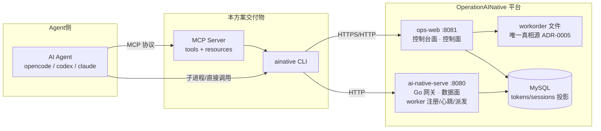
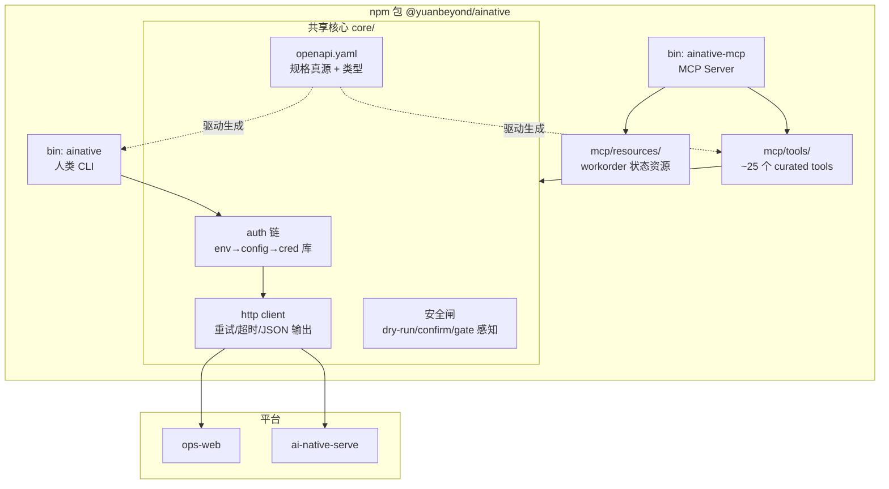
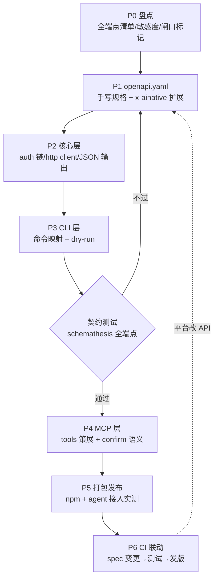
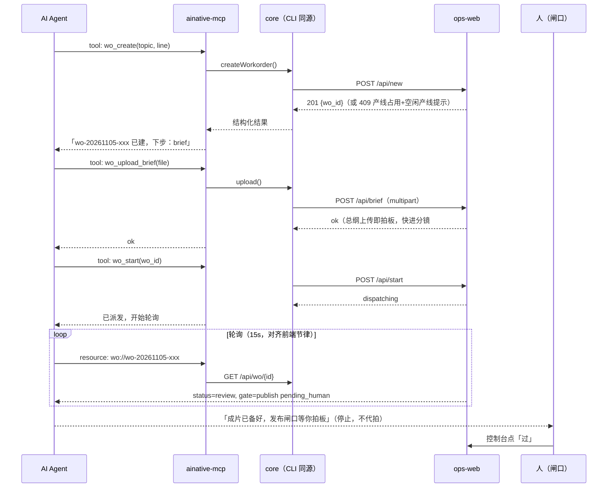
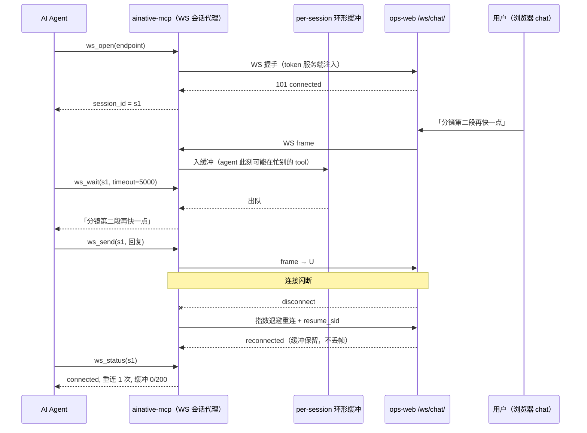
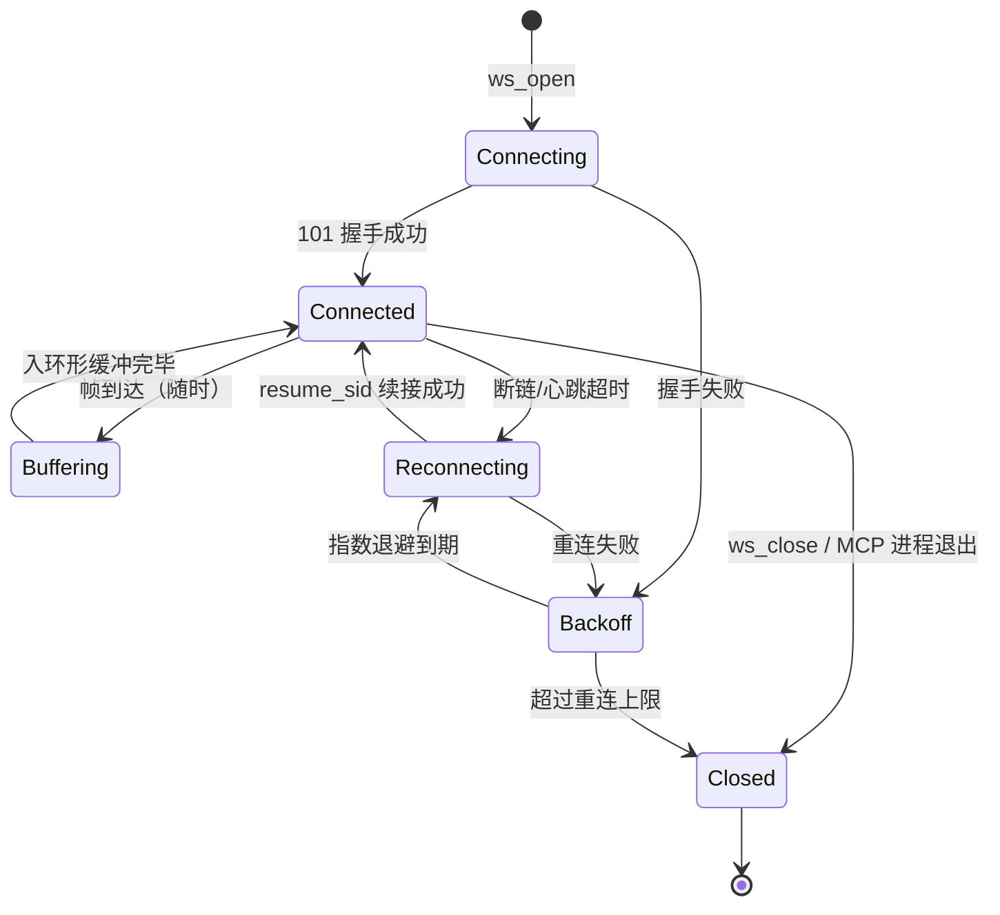
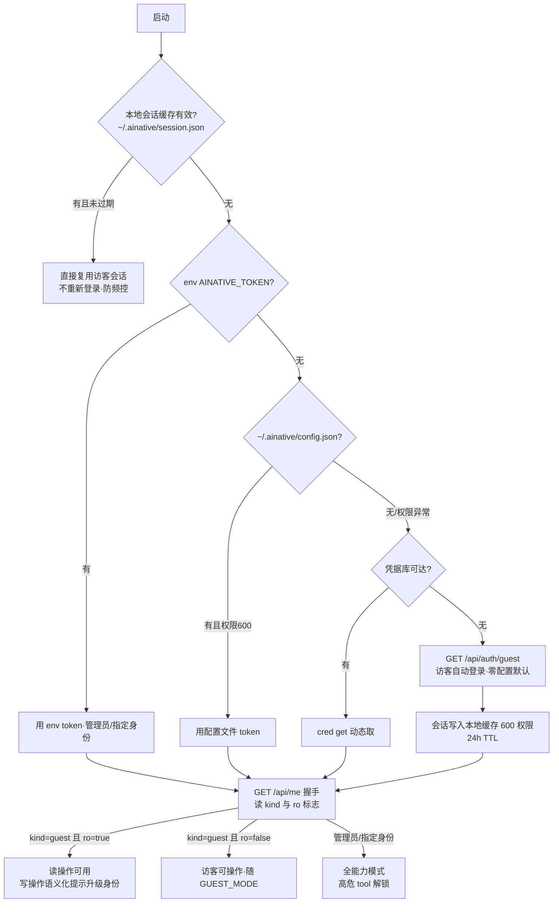
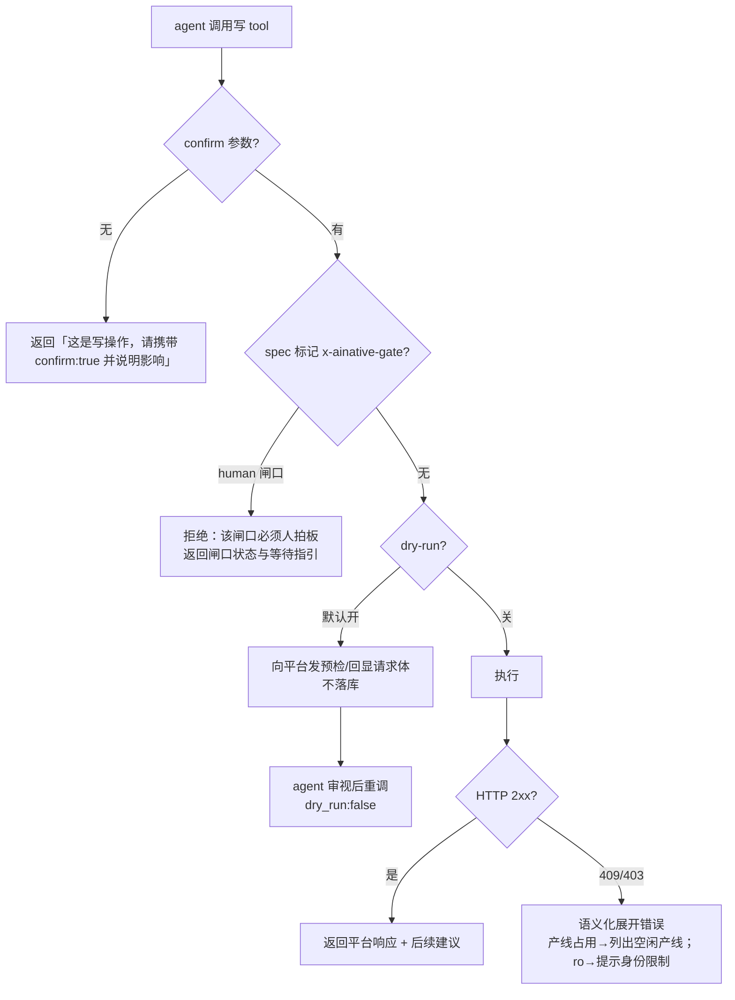
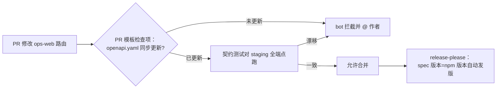

# OperationAINative Agent 插件化：架构与执行文档

> 版本：v1.0（2026-11-05）
> 目标：把整个运营 AI Native 平台抽象为一个 **agent 插件**——agent（Claude/GPT/opencode/codex 等）通过 MCP 调用，能完成平台控制台能做的一切工作。
> 技术路线：**API 全量抽取 → OpenAPI 规格 → CLI 封装 → 内嵌 MCP Server → npm 包分发**。

---

## 1. 结论先行：思路可行性判定

**总体判定：可行，且是当前生态下的正确路线。** 四段式（OpenAPI → CLI → MCP → npm）每一段都有成熟工具链支撑。逐段评估：

| 环节 | 可行性 | 依据 / 条件 |
|---|---|---|
| API 抽取 → OpenAPI | ✅ 可行，**需手写规格** | 平台 API 共 **GET 24 组 + POST 14 个**（盘点见 §2.2），规模适中。但 ops-web 是手写 `BaseHTTPRequestHandler`，**无框架 schema 可自动生成**——OpenAPI 必须手工编写并用契约测试锁定（见 D1） |
| CLI 封装 | ✅ 可行，且有仓内先例 | ADR-0001 已定案「单一消费者用 CLI」；CLI 是最稳定的机器接口，调试友好（agent 可以先 `--dry-run` 再执行） |
| CLI 内嵌 MCP Server | ✅ 可行，业界成熟模式 | GitHub CLI / Sentry / Stripe 均为「CLI + MCP 同包」模式：CLI 负责人用，MCP 负责agent 用，共享同一 HTTP client 与鉴权层 |
| npm 包分发 | ✅ 可行 | 目标 agent（opencode/codex/claude code）都能跑 `npx`；Node 生态对 MCP SDK 支持最好 |

**三个必须正视的坑（路线本身解决不了，要靠设计约束）：**

1. **WebSocket 不在 OpenAPI 体系里**——chat 面板、worker 通道是 WS。但这不构成降级理由：MCP Server 作为常驻进程充当 **WS 会话代理**（缓冲 + 断线续接 + 订阅推送），agent 拿到的是全双工会话句柄；规格侧用 AsyncAPI 描述（见 D5）。
2. **平台有"人类闸口"**——选题/发布等 gate 是 `pending_human`，agent 插件**绝不能绕过**。这是产品红线，不是技术问题（见 D4）。
3. **凭据体系是多层的**（管理员 token / 会话 token / agent 令牌 / 网关共享 token），npm 包是公开分发物，**包里永远不能带凭据**——但这不构成使用摩擦：CLI 默认以**访客身份**零配置开箱（平台既有机制），真实凭据只在需要更高权限时注入（见 D3）。

---

## 2. 现状盘点

### 2.1 平台拓扑（agent 要面对的两台后端）



- **ops-web（控制台）**：工作单全生命周期、闸口、产物、产线、令牌签发、chat 反代。
- **ai-native-serve（网关）**：worker 接入、心跳、任务派发、agent 令牌校验（Go 预编译，只调用不改动）。

### 2.2 API 全量清单（2026-11-05，main @ f34940d 实测盘点）

**ops-web 控制台 API（OpenAPI 覆盖范围）**

| 分组 | 端点 | 方法 | 能力 | 敏感度 |
|---|---|---|---|---|
| 认证 | `/api/auth/guest` | GET | 访客登录（24h 会话） | 低（有频控） |
| | `/api/auth/logout` | GET | 吊销当前会话 | 低 |
| | `/api/auth/gitcode/config` `/start` `/callback` | GET | OAuth 登录流 | 低 |
| | `/api/me` | GET | 当前身份/权限/ro 标志 | 低 |
| | `/api/chat-allowed` | GET | chat 写权限探测 | 低 |
| 工作单 | `/api/wo/{id}` | GET | 单张工作单（含 artifacts 投影） | 读 |
| | `/api/wo/{id}/...` | GET/POST | 状态机操作（gate/pick/skip 等） | **写·过闸** |
| | `/api/new` | POST | 建单（产线独占校验，409 冲突） | **写** |
| | `/api/brief` `/api/upload` `/api/gate` | POST | 总纲/产物上传/闸口拍板 | **写** |
| | `/api/start` `/api/resume` `/api/h` `/api/wo-close` `/api/skip` `/api/pick` `/api/bind-agent` | POST | 派发/恢复/推进/关闭 | **写·触发 agent 执行** |
| 产线 | `/api/lines` `/api/devices` | GET | 产线与设备状态 | 读 |
| 节点 | `/api/agents` `/api/agent-logs` | GET | 网关实况/日志 | 读 |
| 令牌 | `/api/tokens` `/api/token-issue` `/api/token-revoke` | GET/POST | 令牌列表/签发/吊销 | **高危** |
| 统计 | `/api/stats` `/api/overview` `/api/spec` | GET | 面板数据/平台自述 | 读 |
| 包 | `/api/bundle/{...}` | GET | 静态资源包 | 读 |
| WS | `/ws/chat/{sid}` | WebSocket | chat 反代（**不进 OpenAPI**，见 D5） | 写通道 |

**ai-native-serve 网关 API**：worker 注册/心跳/bootstrap 下载、派发信封（`?token=` 回写）、agent 令牌校验。路径清单在 P0 阶段从网关侧补全（Go 二进制，见 §6 P0）。

---

## 3. 目标架构



**分层职责：**

| 层 | 职责 | 交付物 |
|---|---|---|
| **规格层** | OpenAPI 3.1 文档 = 全平台机器可读的能力清单；带 `x-ainative` 扩展（敏感度、闸口标记、幂等性） | `openapi.yaml` |
| **核心层** | HTTP client、凭据解析链、重试/超时、JSON 输出、错误语义化 | `src/core/` |
| **CLI 层** | 每个端点一条命令（`ainative wo get <id>`），`--json` 默认机器可读，`--dry-run` 全写操作支持 | `bin/ainative.js` |
| **MCP 层** | 从规格**策展**（不是照搬）出 ~25 个 tools + workorder 只读 resources；写操作带 confirm 语义 | `bin/ainative-mcp.js` |
| **分发层** | npm 包，双 bin；`npx @yuanbeyond/ainative mcp` 一条命令接入任意 agent | npm registry / 私服 |

---

## 4. 关键设计决策

### D1 · OpenAPI 是手写规格 + 契约测试锁定（而非自动生成）

- **决策**：`openapi.yaml` 手工编写，作为唯一规格真源；CI 里跑契约测试（schemathesis）对真实环境全端点校验。
- **理由**：ops-web 是手写 handler 无 schema，自动生成不存在；手写规格反而逼出「每个端点有明确输入输出定义」——这本身就是给 agent 的说明书。
- **防漂移**：契约测试不过 = 禁止发版。后端改路由必须先改 spec（PR 模板加检查项）。

### D2 · CLI 与 MCP 同包双 bin，MCP 是 CLI 的策展视图

- **决策**：一个包两个 bin。MCP tool 内部直接调 CLI 的命令函数（不是 shell out），保证行为/鉴权/日志完全一致。
- **理由**：两条消费路径一套实现，杜绝「CLI 能 MCP 不能」的偏差；agent 遇到 MCP 没覆盖的操作时，还能 `npx ainative --help` 自救。

### D3 · 凭据解析链：env → 配置文件 → 凭据库 → **访客自动登录（零配置默认）**；包零凭据

- **决策**：
  1. `AINATIVE_TOKEN`（ops-web）/`AINATIVE_SERVE_TOKEN`（网关）环境变量优先；
  2. 其次 `~/.ainative/config.json`（本地开发，权限 600）；
  3. 生产/企业环境接凭证库（cred skill 同款约定）；
  4. **以上都没有 → 自动访客登录**（`GET /api/auth/guest`，平台既有机制），会话缓存到 `~/.ainative/session.json`（权限 600，24h TTL）供后续复用——**首次使用零配置**。
  - npm 包、日志、错误信息、`--verbose` 输出**一律脱敏**，token 只显示前 8 位。
- **红线对齐**：AGENTS.md 安全红线第 1 条（凭据绝不写入文件或日志）。缓存的是**低权限访客会话**（非管理员凭据），泄漏面可控；`ainative auth logout` 即吊销。
- **身份语义**（对齐 #27 登录体系）：
  - 访客身份 = 默认开箱即用，能力随平台 `GUEST_MODE` 走：`open` 可操作，`ro` 只读——CLI 从 `/api/me` 读取 `kind/ro` 并**透传平台侧判定**，不做二次授权；写操作被 403 时语义化提示「当前平台访客只读，配置管理员令牌后解除」；
  - **访客会话必须缓存复用**（24h 内同一会话），严禁每条命令重新登录——平台访客登录有频控（429）；
  - **CLI 侧高危工具加身份护栏**：`token_issue`/`token_revoke`/`wo_close` 等标记 `x-ainative-min-identity: admin` 的 tool，检测到当前是访客身份时拒绝执行并提示升级身份（平台侧闸门之外的双保险）；
  - 需要真实身份/归属时：env 注入管理员令牌，或 `ainative auth login` 引导（GitCode OAuth 本地回调已注册 127.0.0.1，CLI 可起临时回调监听完成浏览器授权）。

### D4 · 写操作安全闸：平台闸口优先，插件不加塞

- **决策**：
  - 所有 POST 操作默认 `--dry-run`（打印将发出的请求与平台侧预检结果）；
  - 标记 `x-ainative-gate: human` 的操作（发布类闸口），插件**只读展示** gate 状态，调写接口会被平台 403/闸口拒绝——插件不提供任何绕过参数；
  - MCP 侧高危工具（token-issue/wo-close/start）要求 agent 在 tool 参数里显式传 `confirm: true`，MCP server 对无 confirm 的写调用返回「请确认」而非执行。
- **理由**：工作单状态机 + 产线独占（WO_LOCK）是平台正确性来源；agent 的价值是**加速通过闸口的准备工作**，不是替人拍板。

### D5 · WS 会话代理：MCP 内建会话管理，全双工不降级

- **决策**：agent 不自己握 socket（模型运行时做不到，也不该做），而是由 **MCP Server 进程充当 WS 会话代理**——它本身是常驻进程，内部维护真实的 WS 长连接，agent 通过 toolset 拿到会话句柄，实现**全双工收发**：

| tool | 语义 |
|---|---|
| `ws_open(endpoint, resume_sid?)` | 建立真实 WS 连接（鉴权由 MCP 服务端注入，token 不经 agent 手），返回 `session_id`；支持 `resume_sid` 断线续接（平台 #6 已修 query 透传） |
| `ws_send(session_id, payload)` | 下行发送，返回 ack |
| `ws_read(session_id)` | **排空收件缓冲**，返回期间到达的全部帧 |
| `ws_wait(session_id, timeout_ms)` | 长等模式：阻塞至下一帧到达或超时（「发一句、等回复」的主用形态） |
| `ws_status(session_id)` | 连接状态/缓冲水位/最近错误 |
| `ws_close(session_id)` | 主动关闭 |

- **不丢消息的关键——服务端收件缓冲**：两次 tool 调用之间到达的帧全部进入 per-session 环形缓冲（默认保留 200 帧 / 1h TTL），agent 何时来读都能拿全，**这是「不降级」的实质**：短会话丢的是连接期间的消息流，缓冲保住的是全量历史。
- **推送增强（可选层）**：把 `ws://{session_id}` 暴露为 MCP resource，agent 可 `resources/subscribe`，帧到达即推 `notifications/resources/updated`——支持订阅的 agent（claude code 等）获得准实时体验；不支持订阅的 agent 用 `ws_read`/`ws_wait` 轮询，**两种模式同一份缓冲，不丢不重**。
- **连接韧性**：MCP Server 内置心跳（对齐平台 #3 的保活机制）+ 指数退避重连 + `resume_sid` 续接；缓冲跨重连保留；`ws_status` 对 agent 透明暴露重连次数。
- **会话生命周期**：绑定 MCP Server 进程——stdio 模式下 agent 会话结束即进程退出，WS 随之关闭（天然清理）；显式 `ws_close` 提前释放。MCP 重启后 agent 可 `ws_open(resume_sid)` 重挂。
- **规格归属**：WS 端点不进 OpenAPI，改用 **AsyncAPI** 描述（URL/鉴权/消息 schema/事件流），与 openapi.yaml 同目录同版本管理——不是「没有规格」，是「异步 API 用异步规格」。
- **理由**：chat 的多轮上下文、worker 通道的事件流都依赖持续连接；缓冲 + 订阅两层交付让全双工能力对 agent 完整可用，且不依赖 MCP 规范未来的流式扩展。

### D6 · 双后端、双命令组，内网直连

- **决策**：CLI 分 `ainative console ...`（ops-web）与 `ainative gw ...`（serve）两个命令组；配置里区分 `--endpoint-public`（WAF/域名，浏览器/远程 agent 用）与 `--endpoint-internal`（8081/8080 直连，同网 agent 用）。
- **理由**：agent 若跑在平台同网（如 No1/myecs 节点），直连绕开 WAF 超时（#24 的教训：同步阻塞被 WAF 掐断）与 CDN 缓存干扰。

### D7 · 版本联动：spec 版本 = CLI 版本

- **决策**：`openapi.yaml` 的 `info.version` 与 npm 包版本同步走 semver；CLI 启动时对平台打一次 `/api/spec`（已有端点）做兼容性握手，大版本不匹配则警告。
- **理由**：平台无框架 schema，靠握手 + 契约测试双保险防「agent 拿旧规格打新后端」。

---

## 5. 最佳实践流程图

### 5.1 构建流水线（一次性建设 + 持续演进）



### 5.2 Agent 调用时序（一次「建单-派发-过闸」全流程）



### 5.2.1 WS 会话代理时序（chat 全双工，不降级）





### 5.3 凭据解析流程（每次 CLI/MCP 启动执行一次）



### 5.4 写操作安全闸（所有 POST 类 tool 的统一前置）



### 5.5 CI 版本联动（防规格漂移）



---

## 6. 执行计划（P0–P5）

| 阶段 | 内容 | 交付物 | 验收标准 | 估时 |
|---|---|---|---|---|
| **P0 盘点**（0.5d） | 全端点复核（含 serve 网关侧从 Go 二进制/运行时补全路径）、每端点标注敏感度/闸口/幂等性；确认 openapi 无自动生成捷径 | `docs/api-inventory.md` | 清单覆盖率 100%（与代码 grep 对照）；网关路径清单成型 | 0.5d |
| **P1 规格**（1.5d） | 手写 `openapi.yaml`（3.1），`x-ainative-*` 扩展；WS 端点用 **AsyncAPI** 描述（D5）；错误响应统一建模（401/403/409/429 语义） | `openapi.yaml` + `asyncapi.yaml` | schemathesis 对 38 个端点生成用例零报错；AsyncAPI 消息 schema 覆盖 chat/worker 两通道；3 个 reviewer 过会 | 1.5d |
| **P2 核心**（2d） | TS 工程、auth 链（D3）、http client（超时/重试/脱敏）、JSON 输出与错误展开 | `src/core/` | 单测覆盖 auth 链三分支；脱敏快照测试通过 | 2d |
| **P3 CLI**（2d） | 全端点命令映射（commander）、`--dry-run`、`--json`、交互兜底；chat 流式子命令 | `bin/ainative` | 平台全能力可用 CLI 完成（对照 §2.2 清单逐条演示）；P0-P3 合计可先发 `0.1.0` 内测 | 2d |
| **P4 MCP**（2d） | 策展 ~25 tools + WS 会话代理 toolset（`ws_open/send/read/wait/status/close` + 环形缓冲 + 重连状态机 + 资源订阅推送，见 D5/§5.2.1）、workorder 只读 resources、confirm 语义、`ainative mcp` 启动 | `bin/ainative-mcp` | opencode/codex 各接入成功；chat 全双工实测：发一句→缓冲→ws_wait 收到→回复，中途 kill 网络重连不丢帧；写 tool 无 confirm 被拒；human 闸口 tool 只读 | 2d |
| **P5 发布**（1d） | npm 发布（私服或公网）、README/quickstart、真实 agent 端到端演示（建单→分镜→产物→过闸展示） | `@yuanbeyond/ainative@1.0.0` | 领导演示场景跑通；安全审查（包内无凭据、日志脱敏审计）通过 | 1d |
| **P6 CI**（1d） | 契约测试进 CI、PR 模板检查项、release-please 版本联动 | CI 流水线 | 模拟一次「改路由不带 spec」被拦截 | 1d |

**总计约 10 人日**，P3 结束即可内部试用，P5 结束可对外交付演示。

---

## 7. 能力映射表（平台能力 → CLI → MCP tool）

| 平台能力 | CLI | MCP tool（策展） | 约束 |
|---|---|---|---|
| 看板总览 | `console stats` / `console overview` | `wo_dashboard` | 只读 |
| 工作单详情/产物 | `console wo get <id>` | `wo_get` + resource `wo://{id}` | 只读 |
| 建单 | `console wo new --topic ... --line ...` | `wo_create` | confirm；409 展开空闲产线 |
| 上传总纲/产物 | `console wo brief / upload` | `wo_upload_brief` `wo_upload_artifact` | confirm |
| 闸口拍板 | `console wo gate --pick N` | `wo_gate_pick` | **human 闸口 → 只读展示，不可代拍** |
| 推进/跳过 | `console wo skip / pick` | `wo_advance` | confirm |
| 派发执行 | `console wo start` | `wo_start_dispatch` | confirm + dry-run 预检 |
| 关闭工作单 | `console wo close` | `wo_close` | confirm（高危） |
| 产线/设备状态 | `console lines / devices` | `lines_status` | 只读 |
| 节点实况/日志 | `console agents / agent-logs` | `agents_fleet` `agent_logs` | 只读 |
| 令牌管理 | `console token ls / issue / revoke` | `token_list` `token_issue` `token_revoke` | **高危**：issue/revoke 必须 confirm + 审计日志 |
| chat | `console chat stream --sid` | `ws_open` `ws_send` `ws_read` `ws_wait` `ws_status` `ws_close`（会话代理，全双工见 D5/§5.2.1） | 缓冲不丢帧；订阅推送为增强层 |
| 登录/身份 | `console auth whoami / guest / logout` | `auth_whoami` | 只读 |
| 网关派发/worker | `gw dispatch / workers / heartbeat` | `gw_dispatch` `gw_workers` | P0 补全后细化 |

---

## 8. 风险与对策

| 风险 | 等级 | 对策 |
|---|---|---|
| 规格漂移（后端改了 spec 没跟） | 高 | D1 契约测试 + D7 版本联动 + PR 模板检查项（§5.5） |
| agent 绕过人类闸口 | 高 | D4 硬拒绝 + 平台侧写闸本来就 403（双保险，不依赖插件自觉） |
| 凭据泄漏进 npm 包/日志 | 高 | D3 零凭据打包 + 脱敏快照测试进 CI；访客自动登录让「不带凭据」与「零配置」兼容 |
| 访客频控 429 / 多 agent 抢登 | 中 | 会话缓存复用（24h 单会话）；缓存文件加锁防多 MCP 实例并发重登 |
| 访客身份的操作归属模糊 | 低 | 工作单归「访客-xxxx」；需归属到人时升级 GitCode/管理员身份（`ainative auth login` 或 env） |
| 高危操作被访客执行 | 中 | 平台侧闸门 + CLI 侧 `x-ainative-min-identity: admin` 护栏双保险（D3） |
| 令牌签发被 agent 滥用 | 中 | token_issue/revoke 列为高危 tool；平台侧令牌已有 expire/审计 |
| WAF 超时误判（同步派发 #24 复现） | 中 | D6 内网直连 profile；CLI 对 long-op 用轮询而非长等待 |
| WS 长连接在 agent 环境不稳 | 中 | D5 会话代理：服务端心跳 + 指数退避重连 + resume_sid 续接 + 环形缓冲跨重连保留；agent 侧无感 |
| 产线独占 409 被当成故障 | 低 | 错误语义化展开：409 → 返回空闲产线建议（平台已提供） |

---

## 9. 与现有架构决策的关系

- **ADR-0001（MCP 暂不使用，单一消费者用 CLI）**：本方案**不推翻**它——CLI 是本体，MCP 是 CLI 的薄壳。当时的触发条件（T1/T2：多消费者/跨机常驻）正是「领导要求抽象为 agent 插件」这个新需求本身，建议补一篇 ADR 记录本次决策升级。
- **ADR-0004（tokens 表结构不动）**：插件走 `/api/token-issue` 等既有端点，不碰表。
- **ADR-0005（文件=真源，DB=投影）**：插件的 workorder resources 读 `/api/wo`（平台已收敛的投影），绝不直连文件或 DB。
- **AGENTS.md 安全红线**：凭据链（D3）、human 闸口（D4）逐条对齐；生产部署仍由运维 agent 执行（2026-11-05 指令）。

---

## 附录 A · MCP 接入示例（交付给使用者）

```jsonc
// opencode / claude code / codex 的 MCP 配置
// AINATIVE_TOKEN 可选——不配则 CLI 自动以访客身份登录（零配置开箱）
{
  "mcpServers": {
    "ainative": {
      "command": "npx",
      "args": ["-y", "@yuanbeyond/ainative", "mcp"],
      "env": {
        "AINATIVE_ENDPOINT": "https://mcptest.api.hwcdeveloper.com",
        "AINATIVE_TOKEN": "<可选：需要管理员/指定身份时，从凭据库注入，不写死>"
      }
    }
  }
}
```

## 附录 B · CLI 使用示例

```bash
# 身份握手（首次配置自检）
npx @yuanbeyond/ainative console auth whoami

# 建单（dry-run 预览 → 确认执行）
npx @yuanbeyond/ainative console wo new --topic "AI Native 运营范式" --line line-1 --dry-run
npx @yuanbeyond/ainative console wo new --topic "AI Native 运营范式" --line line-1 --confirm

# 派发并轮询
npx @yuanbeyond/ainative console wo start wo-20261105-001 --confirm
watch -n 15 "npx @yuanbeyond/ainative console wo get wo-20261105-001 --json | jq .status"
```
